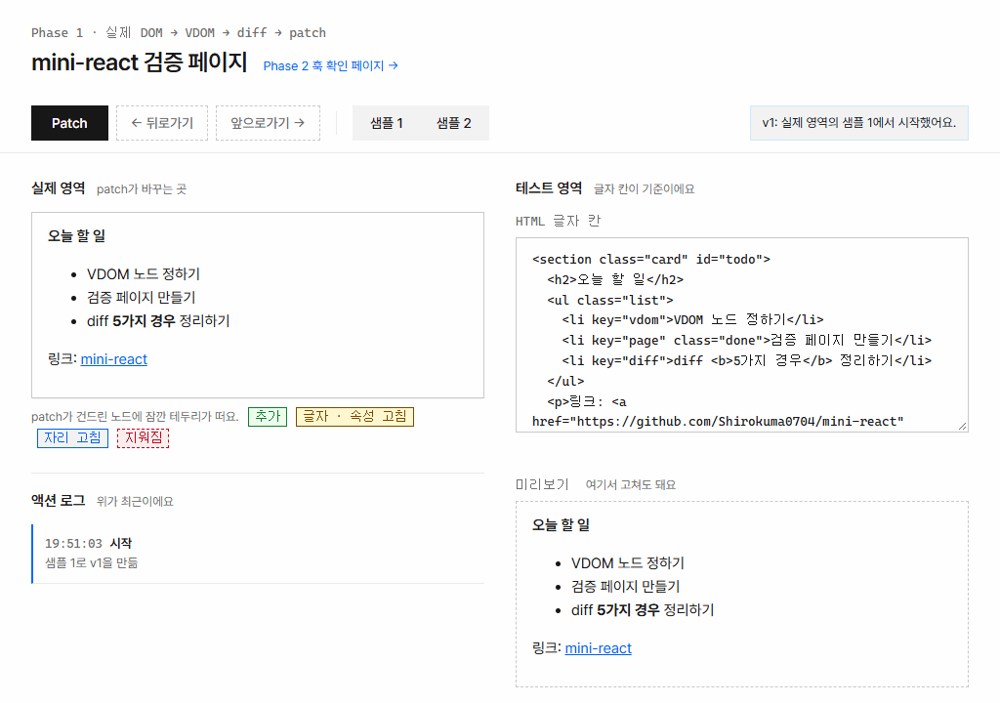
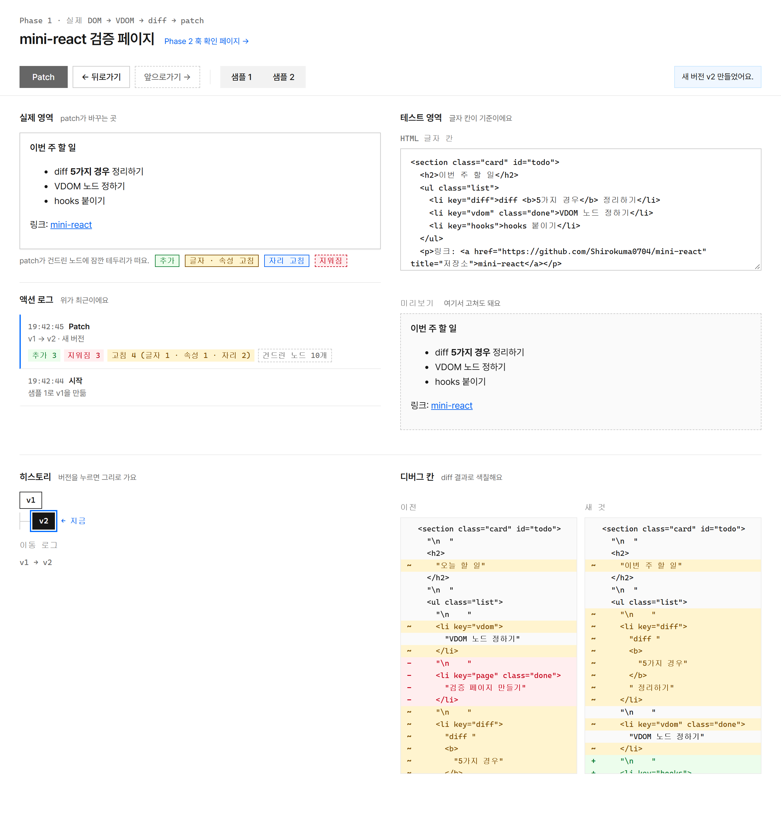
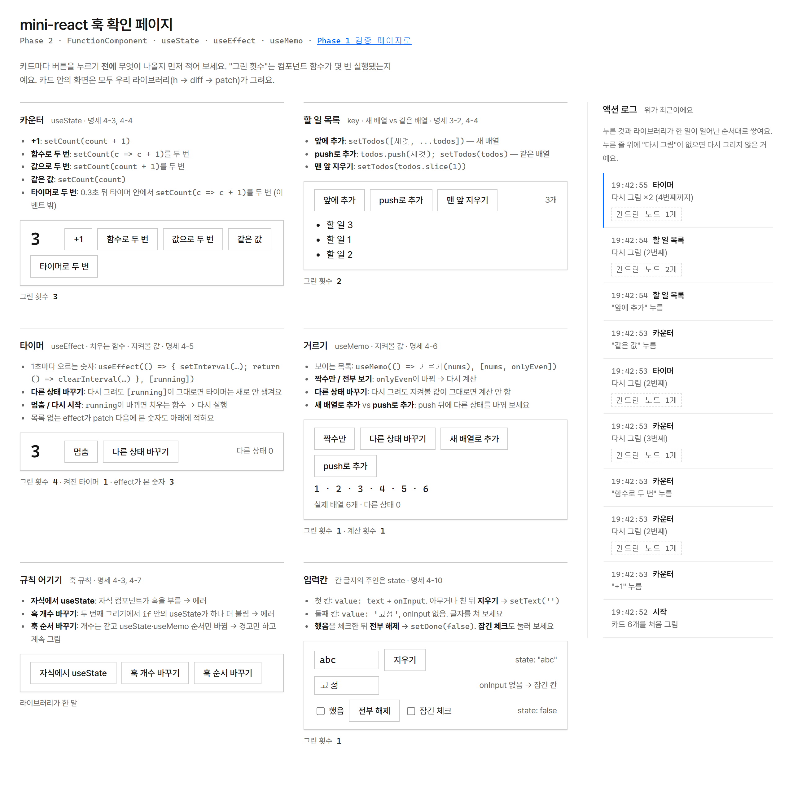

# mini-react

**데모**: [검증 페이지](https://shirokuma0704.github.io/mini-react/) · [훅 확인 페이지](https://shirokuma0704.github.io/mini-react/hooks.html) (설치 없이 브라우저에서 바로 열려요)

React의 핵심 흐름을 바닐라 JavaScript로 다시 만든 프로젝트예요. 실제 DOM을 VDOM으로 읽고, `diff`로 바뀐 곳을 찾고, `patch`로 그 노드만 고쳐요. 그 위에 `FunctionComponent`와 `useState` · `useEffect` · `useMemo`를 올렸어요.



글자 칸에서 목록 맨 앞에 항목 하나를 더하고 Patch를 누른 장면이에요. 액션 로그에 "추가 2 · 건드린 노드 2개"가 찍혀요. 새 `li`와 그 앞의 들여쓰기 글자 노드예요. 이어서 뒤로가기를 눌러요.

| 기간 | 스택 | 역할 |
| --- | --- | --- |
| 2026-11-06 ~ 2026-11-11 (커밋 기준) | 바닐라 JavaScript (ES 모듈), `node --test` + jsdom | 명세 작성 · 검증 (구현 코드는 AI 작성) |

크래프톤 정글 "AI 함께하기" 과제예요. 코드는 AI가 먼저 쓰고, 명세 · 검증 · 이해를 사람이 맡는 형식이에요. 자세한 과정은 [만든 방식](#만든-방식)에 있어요.

- **프레임워크 · 번들러 없음.** 런타임 의존성이 없고, 개발 의존성은 테스트용 jsdom 하나예요.
- **index가 밀려도 틀리지 않는 `patch`.** 아무것도 바꾸기 전에 모든 위치를 실제 노드 참조로 풀어 둬요.
- **최소 이동을 노리지 않는 `key` 재정렬.** 새 순서를 앞에서부터 걷는 단순한 방식을 골랐어요.
- **실행 중에 검사하는 훅 규칙.** 훅 개수가 바뀌면 `patch` 전에 에러를 내고, 화면은 마지막 정상 렌더를 유지해요.
- **눈으로 확인하는 페이지 두 개.** `diff`가 내놓은 바뀜 개수와, 실제로 건드린 DOM 노드 수를 따로 세어 보여 줘요.

## 실행하기

```bash
npm install
```

```bash
npm start
```

`http://localhost:5173/` 에서 열려요. 서버는 `127.0.0.1`에만 붙고, `PORT` 환경 변수로 포트를 바꿀 수 있어요. ES 모듈을 쓰기 때문에 HTML 파일을 `file://`로 직접 열면 동작하지 않아요.

```bash
npm test
```

`node --test`에 jsdom으로 DOM을 붙여 돌려요. 2026-11-11, Node v24.20.0에서 테스트 400개가 모두 통과했어요(실패 0).

## 무엇을 볼 수 있나

| 페이지 | 주소 | 내용 |
| --- | --- | --- |
| Phase 1 검증 페이지 | `/` (`index.html`) · [데모](https://shirokuma0704.github.io/mini-react/) | HTML을 고치고 Patch를 누르면 바뀐 노드만 실제 영역에 반영돼요 |
| Phase 2 훅 확인 페이지 | `/hooks.html` · [데모](https://shirokuma0704.github.io/mini-react/hooks.html) | 훅 기능마다 카드가 하나씩 있고, 버튼을 눌러 동작을 확인해요 |

**검증 페이지**



샘플 1에서 제목 글자를 바꾸고, 목록 항목 하나를 맨 앞으로 옮기고, 하나를 지우고, 하나를 더한 뒤 Patch를 누른 화면이에요.

- **실제 영역**: `patch`가 바꾸는 곳이에요. 건드린 노드에 잠깐 테두리가 떠요.
- **테스트 영역**: HTML 글자 칸과, 직접 고칠 수 있는 미리보기예요. 닫히지 않은 태그나 겹친 `key`는 경고 줄로 알려요.
- **히스토리**: git처럼 트리예요. 예전 버전으로 돌아가 Patch하면 새 가지가 생기고, 버전을 누르면 그리로 이동해요.
- **디버그 칸**: 이전 VDOM과 새 VDOM을 나란히 놓고 `diff` 결과로 색을 칠해요. 글자를 따로 비교하지 않기 때문에, `diff`가 틀리면 여기서 보여요.
- **액션 로그**: 액션마다 한 줄이에요. 바뀜 개수는 `diff` 결과에서, 건드린 노드 수는 `MutationObserver`로 실제 영역을 지켜봐서 세요.

**훅 확인 페이지**



카드 여섯 개예요: 카운터(`useState`, 묶기), 할 일 목록(`key`, 새 배열과 같은 배열), 타이머(`useEffect`와 치우는 함수), 거르기(`useMemo`), 규칙 어기기(훅 규칙), 입력칸(제어 입력칸). 규칙 어기기를 뺀 카드에는 "그린 횟수"(컴포넌트 함수가 실행된 횟수)가 적혀요.

## 구조

```
Phase 1  (index.html)

  HTML 글자 --htmlToVdom--> 새 VDOM
  diff(이전 VDOM, 새 VDOM) --> 바뀜 목록
  patch(실제 영역, 바뀜 목록) --> 바뀐 노드만 고침

Phase 2  (hooks.html)

  set() --microtask--> update() --> App() --> expand --> 새 VDOM
  diff --> patch --> 이벤트 · 입력칸 맞추기 --> effect 실행
```

Phase 1의 VDOM 노드는 두 가지 모양이에요.

```js
{ kind: 'text', text }
{ kind: 'element', tag, attrs, children }
```

Phase 2에서 `h()`가 만든 요소 노드는 `events`(핸들러)와 `props`(입력칸의 `value` · `checked`) 칸을 더 가질 수 있어요. `h(Component, props)`는 `expand`가 펼치기 전까지 `{ kind: 'component', fn, props }`예요. `diff`는 `events`와 `props`를 보지 않아요.

`diff`가 내놓는 바뀜은 네 가지예요: 추가(`insert`), 지워짐(`remove`), 교체(`replace`), 고침(`update`). 고침은 글자 · 속성 · 자리로 나뉘어요. 순서만 바뀐 것은 따로 종류를 두지 않고 "자리 고침"으로 내요.

```
src/
  core/         domToVdom.js  render.js  diff.js  patch.js  events.js  vdomEqual.js
  component/    h.js  component.js  controlled.js
  page-tools/   touched.js  actionLog.js  motion.js          두 페이지가 같이 쓰는 도구
  verify-page/  app.js  main.js  sync.js  lint.js  history.js  treeView.js  debugView.js  samples.js
  hooks-page/   hooksPage.js  hooksMain.js  hooksLog.js  liveMotion.js
test/           테스트 파일 25개
server.js       정적 서버 (Node http 모듈만 사용)
```

- `src/core/`: Phase 1이에요. DOM ↔ VDOM 변환, `diff`, `patch`, 이벤트 중계.
- `src/component/`: Phase 2예요. `h()`, 컴포넌트 펼치기, 훅은 모두 `src/component/component.js`에 있어요.

## 설계 결정

"정한 쪽"이 **명세**인 것은 작성자가 인터뷰에서 정한 것이고, **AI**인 것은 명세가 비워 둔 칸을 AI가 채운 것이에요.

### patch: 위치를 먼저 노드 참조로 풀어 둔다 (AI)

바뀜 목록의 위치는 뿌리에서부터 이어 적은 자식 index예요. 그런데 노드 하나를 지우면 뒤 형제의 index가 한 칸씩 당겨져요. 0번을 지운 뒤에 "2번의 글자를 고쳐라"를 그대로 따르면, 원래 3번이던 노드를 에러 없이 고치게 돼요.

그래서 `patch`는 아무것도 바꾸기 **전에** 이전 트리의 위치를 전부 실제 노드 참조로 바꿔 쥐고, 그 뒤로는 index 대신 참조로 일해요.

```
0. 이전 위치를 전부 실제 노드로 바꿔 쥠      (화면은 아직 그대로)
1. 교체         그 자리에서 새 노드로 바꿔 끼움
2. 고침         글자와 속성을 고침
3. 지워짐       쥐고 있던 노드를 뺌
4. 추가 · 자리  부모마다 새 index가 작은 것부터  insertBefore(node, childNodes[index] ?? null)
```

- 지워짐은 이전 트리의 위치를, 추가는 새 트리의 위치를 써요. 그래서 바뀜 하나가 위치를 두 개(이전 / 새) 들고 다녀요. 이것이 비용이에요.
- `insertBefore`는 이미 붙어 있는 노드를 옮기기도 하므로, 추가와 자리 고침을 같은 걸음으로 처리해요.
- 실제 영역은 항상 VDOM에서 그려지기 때문에 VDOM의 자식 index와 실제 DOM의 자식 index가 같아요. 주석을 VDOM에 넣지 않는 결정이 이 전제를 받쳐 줘요.
- `test/patch.test.js`가 무작위 목록 400쌍으로 `patch(diff(a, b))`의 결과가 `b`와 같은지 확인해요.

### key 재정렬: 줄 따라 걷기 (명세)

`key`가 같은 노드끼리 짝지은 뒤, 새 순서를 앞에서부터 걸으며 그 자리에 있어야 할 노드가 없으면 옮겨요. 최소 이동 횟수는 목표로 삼지 않았어요. 명세의 결정이 "옮김 수가 최소가 아니어도 된다"예요.

비용은 이동 횟수예요. `A B C D → B C D A`에서 이 구현은 자리 고침을 3개 내요(B, C, D). LIS 기반 방식이라면 A 하나만 옮겨요. 화면 결과는 같고, 네 노드 모두 새로 만들지 않고 재사용돼요.

### 그 밖의 결정

| 결정 | 이유 | 비용 | 정한 쪽 |
| --- | --- | --- | --- |
| 주석은 VDOM에 넣지 않음 | 화면에 그리는 것이 없어서 실을 필요가 없음 | 글자 칸에 쓴 주석이 미리보기를 고친 뒤 사라짐 | 명세 |
| `key`가 일부에만 있으면, 없는 노드는 바로 뒤의 `key` 노드에 붙어 한 덩어리로 움직임 (맨 뒤면 앞에 붙음) | 명세에 이유 기록 없음. 들여쓰기 공백 글자 노드가 대개 여기에 해당함 | 한 목록에 두 가지 짝짓기 규칙이 섞임 | 명세 |
| `key`가 하나도 없는 목록은 양 끝에서 같은 노드를 넘기고, 남은 가운데만 index끼리 비교 | 명세에 이유 기록 없음. 글 속 태그처럼 `key` 없는 목록이 이 경우임 | 끝을 비교할 때 서브트리를 통째로 깊게 비교함 | 명세 |
| 겹친 `key`는 나온 순서대로 짝지음 | 바뀐 게 없는 목록이 지워짐 + 추가로 나오면 Patch가 빈 버전을 만듦 | 겹친 `key`에서의 결과는 보장하지 않음 (페이지가 경고함) | AI |
| 이벤트는 요소와 이벤트 종류마다 중계 리스너를 한 번만 붙이고, 다시 그릴 때는 저장된 핸들러만 바꿈 (`src/core/events.js`) | `diff`가 이벤트를 바뀜으로 내지 않으면서도, 이전 렌더의 핸들러가 남지 않음 | 핸들러가 없어져도 리스너는 남음 (포인터만 비움) | 명세 |
| `set`을 여러 번 불러도 microtask에서 한 번만 다시 그림 | 이벤트 핸들러 끝에서 묶으면 타이머 같은 바깥 호출은 묶이지 않음 | `set` 직후에는 화면이 아직 이전 값임 | 명세 |
| "같은 값"은 `Object.is`로 판단하고, 같으면 다시 그리지 않음 | `set` · `useEffect` · `useMemo`가 한 가지 규칙을 같이 쓸 수 있음 ("고쳤음" 표시를 따로 넘기는 방식은 `useEffect` · `useMemo`가 볼 수 없음) | 배열 · 객체는 안을 고치지 말고 새로 만들어야 함 | 명세 |
| `useEffect`는 `patch`가 끝난 뒤에 실행 | 컴포넌트 함수가 도는 동안에는 첫 화면의 노드가 아직 없음 | effect가 `set`을 부르면 다시 그리기가 한 번 더 예약됨 | 명세 |
| 훅 개수가 지난 렌더와 다르면 에러, 개수는 같고 종류만 다르면 렌더당 한 번 `console.warn` | 명세에 이유 기록 없음. 훅은 호출 순서로 자기 칸을 찾으므로 개수가 달라지면 칸이 어긋남 | 조건문 안에서 훅을 부를 수 없음 | 명세 |
| 자식 컴포넌트가 훅을 부르면 에러 | 조용히 무시하면 잘못된 화면이 계속 보임 | state는 전부 루트에 둠 | 명세 |
| 입력칸의 `value` · `checked`는 state를 따르고, 핸들러 없는 칸은 잠김 (`src/component/controlled.js`) | 칸 글자의 주인을 state 하나로 둠 | `value`를 준 칸은 `onInput`이 있어야 입력됨 | 명세 |
| 잠긴 칸을 되돌리는 시점은 microtask가 아니라 task (`requestAnimationFrame`, 없으면 `setTimeout 0`) | 실제 브라우저의 체크박스 클릭은 `input`과 `change` 사이에 microtask를 비워서, microtask로 되돌리면 `onChange`가 되돌려진 값을 읽음 | 되돌리기 전까지는 칸에 친 값이 들어 있음 | AI |
| 서버는 허용 목록에 있는 파일만 보냄 (`server.js`) | Windows에서는 같은 폴더에 닿는 경로 표기가 여러 가지라 차단 목록으로는 막히지 않았음 | 페이지가 쓰는 파일 종류가 늘면 패턴을 고쳐야 함 | AI |

거부된 렌더(훅 개수 에러, 자식의 훅 호출, 컴포넌트 함수의 예외)는 되돌려요. 그 렌더가 바꾼 훅 칸은 원래대로 돌아오고, 그 렌더가 예약한 effect는 실행되지 않아요. 두 가지는 되돌리지 않아요: 그 전에 `set`이 저장한 state 값, 그리고 실패한 렌더에서 다시 계산된 `useMemo` 값이에요.

## 만든 방식

이 프로젝트는 "AI가 코드를 먼저 쓰고, 사람은 명세 · 검증 · 이해를 맡는다"는 과제 형식으로 만들었어요. 구현 코드와 테스트는 Claude가 작성했어요.

- **명세**: 작성자가 인터뷰에 한 질문씩 답하면서 자기 말로 정했어요. 명세가 비워 둔 칸을 AI가 채운 곳은 명세에 AI 표시를 남겼고, 위 표의 "정한 쪽"이 그 구분이에요. 명세 문서는 이 저장소에 들어 있지 않아요.
- **구현**: 기능 26개로 나눠 만들었어요. 역할 나눔이 기록된 구간은 Phase 2(14~22번)예요. Claude Opus가 명세를 보고 테스트를 먼저 쓰고, Claude Sonnet 워커가 테스트를 고치지 않고 구현하고, Opus가 테스트를 다시 돌리고 변경을 리뷰했어요.
- **교차 검증**: 다른 회사의 모델인 Codex가 묶음 단위로 코드를 검증했어요. 21~26번은 Codex 검증 없이 넘어갔어요.
- **작성자 확인**: 26개 모두 작성자가 직접 확인했어요. 1~21번은 대부분 예상 결과를 먼저 적고 페이지에서 조작해 본 것이고, 22번은 테스트를 직접 실행해 확인했어요. 23~26번(액션 로그, 모션)은 페이지에서 써 보며 확인했고, 확인 시각과 내용은 따로 기록하지 않았어요.

교차 검증과 실제 브라우저 확인이 찾아낸 것 가운데 세 가지예요.

- 거부된 렌더가 예약한 effect가, 나중의 정상 렌더 뒤에 실행되던 문제 (Codex)
- `patch`의 무작위 테스트가 난수 계산의 부동소수점 넘침 때문에 자리 고침을 한 번도 만들지 않던 문제 (Codex)
- jsdom 테스트는 통과했지만 실제 브라우저에서는 체크박스 클릭이 되돌려지던 문제 (브라우저 확인)

## 한계

- **렌더 중에 `set`을 부르면 끝나지 않아요.** 렌더할 때마다 새 다시 그리기가 예약되고, React의 "Too many re-renders" 같은 차단 장치가 없어요. jsdom에서 잰 결과(2026-11-11): 렌더 안에서 매번 `set`을 부르는 컴포넌트를, 실험 쪽에서 20000번 뒤에 `set`을 멈추게 해 두고 돌리면 에러 없이 20001번 렌더돼요. mount 전에 걸어 둔 0 ms 타이머는 마지막 렌더 때까지 실행되지 않았어요. 브라우저에서는 재지 않았어요.
- **훅은 루트 컴포넌트에서만 쓸 수 있어요.** 과제의 조건이에요. state는 전부 루트에 있고 자식에게는 props로 내려 줘요.
- **unmount가 없어요.** 그래서 `useEffect(fn, [])`의 치우는 함수는 불리지 않아요.
- **컴포넌트는 노드 하나만 돌려줄 수 있어요.** 배열을 돌려주는 것은 지원하지 않아요.
- **다시 그리기는 항상 루트부터예요.** 컴포넌트 함수를 전부 다시 실행한 뒤 `diff`가 바뀐 곳을 골라요.
- **`key` 재정렬은 최소 이동이 아니에요.** [설계 결정](#key-재정렬-줄-따라-걷기-명세)에 적은 대로예요.
- **SVG · MathML 안의 일부 태그는 HTML 글자로 썼다가 다시 읽으면 내용이 달라질 수 있어요.** Codex가 지적했고, 고치지 않은 채 기록에 남아 있어요.
- **브라우저 종류가 적힌 확인 기록은 Chromium 계열뿐이에요.** Firefox와 Safari는 확인 기록이 없어요.

## 다른 구현과 비교

같은 과제를 팀원이 따로 구현한 빌드(TypeScript)와 나란히 놓은 표예요. 양쪽 코드를 읽고 정리한 것이고, 같은 입력으로 돌려서 비교한 것은 아니에요.

| 주제 | 이 빌드 | 팀원 빌드 |
| --- | --- | --- |
| 실제 노드 찾기 | VDOM 경로를, 바꾸기 전에 노드 참조로 풀어 둠 | VNode마다 `el`을 들고, diff가 `next.el = old.el`로 이어 줌 |
| 끼울 위치 | 새 트리의 index, 앞에서 뒤로 | 새 트리의 오른쪽 형제(anchor), 오른쪽에서 왼쪽으로 |
| `key` 재정렬 | 줄 따라 걷기 (최소 아님) | LIS로 최소 이동 |
| 일부만 `key` / 겹친 `key` | `key` 없는 노드를 다음 `key` 노드에 묶음, 겹친 것은 순서대로 짝 | 경고 후 index 비교로 대체 |
| 훅 개수 검사 | 개수가 바뀌면 에러 + 되돌림 | 개수 검사 없음 |
| 렌더 중 `set` | 막지 않음 ([한계](#한계)) | 에러를 던짐 |
